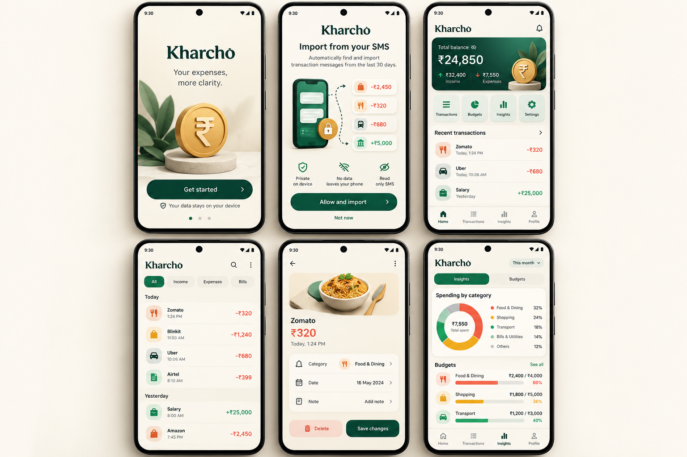
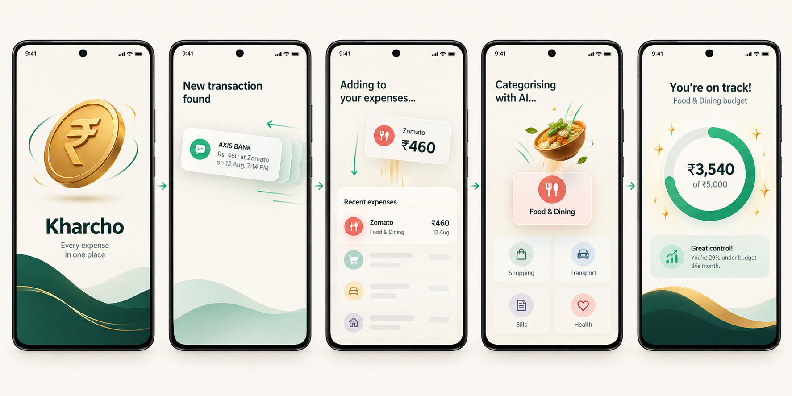

# Kharcho V1 Design Specification

## Visual direction

Kharcho is a warm, premium money companion. It is not a cold banking product or a childish game. Finance information leads. Small 3D details add delight and recognition.

## Brand

### Name

Kharcho

### Logo direction

Use an abstract K shaped mark with a rupee inspired ledger path. The mark is strongest as an Android launcher icon, splash asset, and small navigation accent. It must also have a simple flat vector version before release.

## Colour system

| Token | Hex | Use |
| --- | --- | --- |
| Ivory | `#FAF7F0` | App canvas and light surfaces |
| Deep Forest | `#163D32` | Primary text, balance card, navigation |
| Emerald | `#29B879` | Primary action, income, selected states |
| Saffron | `#E8A63A` | Small highlights and 3D rupee accent |
| Muted Coral | `#E66A5C` | Expense amounts and warnings |
| Pale Sage | `#DDEEE4` | Insight panels and quiet UI surfaces |
| Ink | `#17201C` | High contrast body text |

Never communicate income or expenses through colour alone. Use plus and minus signs, labels, and accessible contrast.

## Typography

1. Headline: bold, compact serif or editorial display face for brand moments only.
2. Product UI: highly legible modern sans serif.
3. Primary amount: 40 to 48sp, semibold or bold.
4. Screen title: 28 to 32sp, semibold.
5. Transaction merchant: 16sp, medium.
6. Supporting detail: 13 to 14sp, regular.

## Layout

1. Base spacing: 4 point scale.
2. Screen gutters: 20dp.
3. Card radius: 20dp.
4. Bottom sheets: 28dp top corners.
5. Tap target: minimum 48dp.
6. Use generous ivory space around dense transaction data.

## Core screens

### 1. Welcome

Purpose: make the privacy promise before permission.

Content:

1. Kharcho wordmark.
2. One 3D rupee or abstract logo object.
3. Clear value statement.
4. Primary Get started button.
5. Small local only privacy statement.

### 2. SMS permission and import

Purpose: explain exactly what will happen and request consent.

Content:

1. Import period chips: 7 days, 30 days, 90 days.
2. Transaction message illustration.
3. Three privacy reassurance points.
4. Primary Allow and import button.
5. Manual tracking alternative when permission is not granted.

### 3. Home dashboard

Purpose: answer money status in five seconds.

Content:

1. Dark forest balance card with income, expense, and net context.
2. Small 3D rupee object as a decorative detail only.
3. Short monthly insight card.
4. Top categories in compact cards with 3D category object.
5. Recent transactions.
6. Bottom navigation and central add button.

### 4. Transactions

Purpose: scan, filter, and correct transaction history quickly.

Content:

1. Filter chips: All, Income, Expenses, account, category.
2. Date grouped transaction rows.
3. Merchant, payment method, account suffix, date, amount, and direction.
4. Coral negative amount and emerald positive amount.

### 5. Transaction detail

Purpose: make correction fast without overwhelming users.

Content:

1. Merchant and amount in hero region.
2. Category selector.
3. Account and payment method.
4. Date and note.
5. Save changes action.
6. Delete action separated from save and styled as destructive.

### 6. Insights and budgets

Purpose: turn raw SMS into clear spending signals.

Content:

1. Spending by category visualization.
2. Category legend with exact amounts.
3. Budget progress list.
4. Positive reinforcement for under budget progress.

## 3D system

3D is a visual accent, never the navigation system.

| Asset | Location | Rule |
| --- | --- | --- |
| Rupee logo | Welcome, splash, balance card | One main object per screen |
| Food object | Food category card | Small and static after entrance |
| Travel object | Transport category card | Small and static after entrance |
| Bill object | Bills category card | Small and static after entrance |
| Shopping object | Shopping category card | Small and static after entrance |

Do not show 3D objects in every transaction row. Use flat icons there for speed and clarity.

## Motion system

| Moment | Motion | Duration |
| --- | --- | --- |
| Splash | Logo rotates once, then settles | 600ms |
| Imported SMS | Transaction card slides in with gentle elevation | 260ms |
| Auto category | Category object pops into card | 220ms |
| Add expense | Amount moves into feed and total updates | 280ms |
| Under budget | Small saffron sparkle and emerald ring fill | 420ms |
| Navigation | Fade and 12dp slide | 280ms |

Respect Android Reduce Motion. Replace decorative transformations with simple fades.

## Interaction principles

1. One primary action per screen.
2. Finance data always reads before decoration.
3. No autoplaying loops that consume attention.
4. Feedback is immediate after import, edit, save, or delete.
5. Empty states should guide users to allow SMS import or add a manual entry.

## Assets needed before build

1. Flat SVG logo for launcher, toolbar, and monochrome usage.
2. Final Android adaptive icon set.
3. Optimized category 3D render assets in light and dark compatible variants.
4. Rive or Reanimated animation specifications.
5. Typography license decision.
